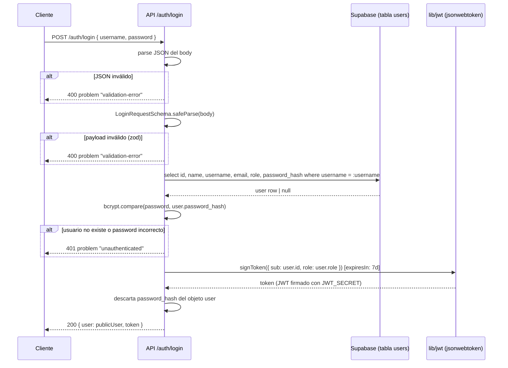
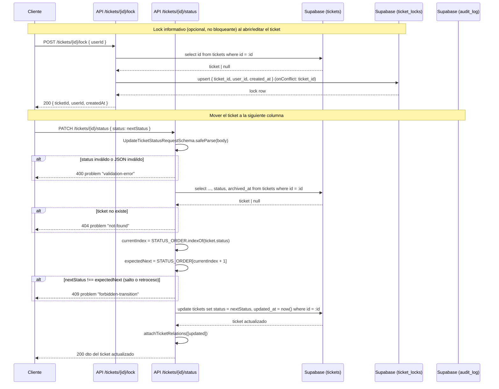
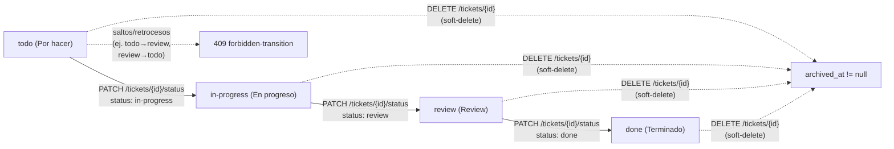

# Diagramas — Mini Jira (basados en código real)

> Generados a partir de `docs/specs.md` y las rutas reales del backend en
> `apps/api/src/app/api/**`. Donde el código difiere de lo descrito en specs,
> se anota como **discrepancia** al pie del diagrama correspondiente.
>
> Archivos revisados: `docs/specs.md`, `apps/api/src/middleware.ts`,
> `apps/api/src/app/api/auth/login/route.ts`,
> `apps/api/src/app/api/auth/register/route.ts`,
> `apps/api/src/lib/jwt.ts`, `apps/api/src/lib/ownership.ts`,
> `apps/api/src/app/api/tickets/[id]/status/route.ts`,
> `apps/api/src/app/api/tickets/[id]/status/schema.ts`,
> `apps/api/src/app/api/tickets/[id]/route.ts`,
> `apps/api/src/app/api/tickets/[id]/lock/route.ts`,
> `apps/api/src/app/api/audit/[ticketId]/route.ts`,
> `apps/api/src/lib/audit.ts`, `apps/api/src/lib/schemas.ts`.

---

## 1. Flujo de autenticación JWT (login)

`/auth/register` sigue el mismo patrón (valida con `RegisterRequestSchema`,
hashea con `bcrypt.hash`, inserta en `users`, detecta `23505` como
username/email duplicado, y emite el mismo tipo de JWT con `signToken`),
devolviendo 201 en lugar de 200.

### Discrepancias encontradas (diagrama 1)

- **El JWT se emite pero nunca se valida.** `apps/api/src/lib/jwt.ts` solo
  exporta `signToken`; no existe `verifyToken` ni lectura del header
  `Authorization` en ningún `route.ts` del backend, y
  `apps/api/src/middleware.ts` solo aplica cabeceras CORS (no hace
  autenticación). El propio código lo documenta explícitamente:
  > "El token se emite en /auth/register y /auth/login por contrato, pero en
  > esta fase ningún endpoint valida Authorization."
  Esto significa que, tras el login, **ningún endpoint protegido verifica el
  token** devuelto; la identidad del actor se pasa en texto plano como
  `actorId` en el body/query de cada request (ver `apps/api/src/lib/ownership.ts`,
  comentario: "Fase sin JWT: el actor se identifica con un id explícito en el
  request... nunca derivado de Authorization"). El PRD no detalla este punto
  explícitamente, pero es una brecha relevante entre "autenticación JWT" (tal
  como se pidió la tarea) y lo realmente implementado: el JWT hoy es solo un
  artefacto emitido al loguearse, no un mecanismo de autorización activo en
  las demás rutas.

---

## 2. Flujo de mover un ticket (cambio de status) con lock y auditoría

### Discrepancias encontradas (diagrama 2)

- **El cambio de status NO escribe en `audit_log`.** `audit.ts` define el
  tipo `AuditAction = 'created' | 'updated' | 'archived' | 'status_changed'`
  y la documentación OpenAPI del endpoint `GET /audit/{ticketId}`
  (`apps/api/src/app/api/audit/[ticketId]/schema.ts`) describe explícitamente
  que registra `status_changed`. Sin embargo,
  `apps/api/src/app/api/tickets/[id]/status/route.ts` **nunca llama a
  `recordAuditEntry`**: solo `tickets/route.ts` (acción `created`) y
  `tickets/[id]/route.ts` (acciones `updated` y `archived`) lo hacen. El
  valor `'status_changed'` está definido en el enum y en los schemas de
  OpenAPI pero no se genera en ningún punto del código actual — hueco entre
  specs/contrato documentado y la implementación real.
- **El lock no se verifica ni se limpia en el cambio de status.** El
  endpoint `PATCH /tickets/{id}/status` no lee ni borra filas de
  `ticket_locks`; el lock es puramente informativo (como indica el nombre
  "soft lock") y vive en un endpoint totalmente independiente
  (`/tickets/{id}/lock`). No hay ninguna relación en código entre ambos
  endpoints — el diagrama los representa como flujos separados porque así
  están implementados.
- **No hay verificación de ownership/rol en el cambio de status.** A
  diferencia de `PATCH /tickets/{id}` (que usa `resolveActor` +
  `isOwnerOrAdmin`), el endpoint de status no recibe `actorId` en el body
  (ver `UpdateTicketStatusRequestSchema`, que solo define `status`) y no
  valida quién hace el cambio. Esto contradice RF-04 del PRD ("Un Usuario
  normal puede... cambiar su estado [de tickets propios/asignados]"): en la
  implementación actual, cualquier llamada autenticada o no puede cambiar el
  status de cualquier ticket, sin importar si el actor es su creador, un
  asignado o un admin.
- **El status se puede cambiar aunque el ticket esté archivado.** La query
  trae `archived_at` pero el código nunca comprueba su valor antes de
  permitir la transición de `status`. No hay información en specs.md sobre
  si un ticket archivado debería congelar su status; se deja documentado
  como hueco/comportamiento no especificado en vez de asumirlo.

---

## 3. Ciclo de vida del ticket (estados + soft-delete)

`STATUS_ORDER = ['todo', 'in-progress', 'review', 'done']`
(`apps/api/src/lib/schemas.ts`): la ruta de status calcula
`currentIndex = STATUS_ORDER.indexOf(ticket.status)` y solo acepta
`STATUS_ORDER[currentIndex + 1]` como siguiente valor — cualquier otro valor
(salto hacia adelante o retroceso) responde `409 forbidden-transition`. Esto
coincide con RF-13 del PRD ("La transición entre estados es secuencial y
obligatoria... no se permite saltar columnas") y con el comentario del propio
schema OpenAPI: "Transición secuencial obligatoria todo→in-progress→
review→done, un paso a la vez, sin saltos ni retrocesos."

El archivado (`archived_at`) es independiente del campo `status`: es una
columna de timestamp nullable que se setea en `DELETE /tickets/{id}`
(`apps/api/src/app/api/tickets/[id]/route.ts`), sin condicionar ni resetear
el `status` del ticket, y puede ocurrir desde cualquiera de los 4 estados —
consistente con RF-06 ("El borrado de tickets es lógico... nunca físico").

### Discrepancias encontradas (diagrama 3)

- Ninguna respecto a la secuencialidad de estados: el código implementa
  fielmente RF-13 (orden fijo, sin saltos, sin retrocesos).
- Ya señalado en el diagrama 2: el status puede modificarse sobre un ticket
  con `archived_at` ya seteado, porque el endpoint de status no lo comprueba.
  Specs.md no define el comportamiento esperado para este caso, así que se
  deja como hueco documentado en vez de inventar una regla.
- Specs.md (RF-05) dice que el soft-delete de un usuario normal se limita a
  tickets que creó o en los que fue asignado, "dejando trazabilidad del
  cambio" para los admins. El código sí registra auditoría en el archivado
  (`recordAuditEntry({ action: 'archived' })` en
  `apps/api/src/app/api/tickets/[id]/route.ts`) y sí aplica
  `isOwnerOrAdmin`, por lo que este requerimiento específico está
  correctamente implementado (sin discrepancia).
